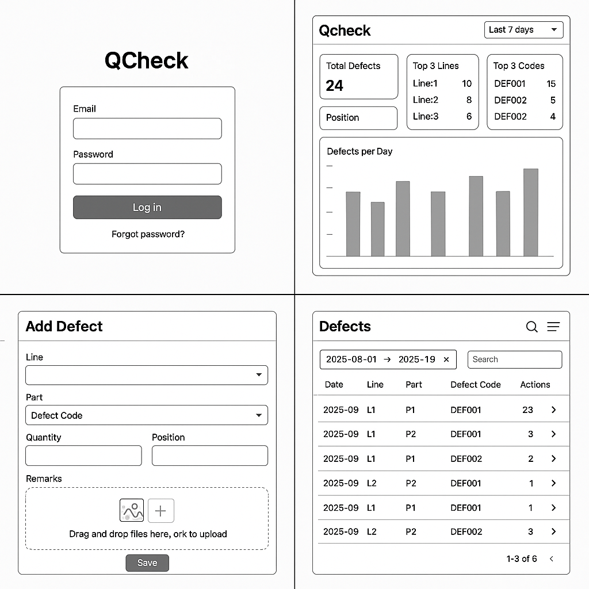

# Qcheck
품질 Saas 사이드 프로젝트 

# DB
postgresql 17.6 설치페이지
https://www.enterprisedb.com/downloads/postgres-postgresql-downloads

psql 환경변수 등록 필요
ex: C:\Program Files\PostgreSQL\17\bin 경로를 PATH 환경 변수에 추가

psql을 이용하여 DB 생성 필요

psql 접속 방법
psql -U "사용자"
CREATE DATABASE qcheck;

# 구조도

